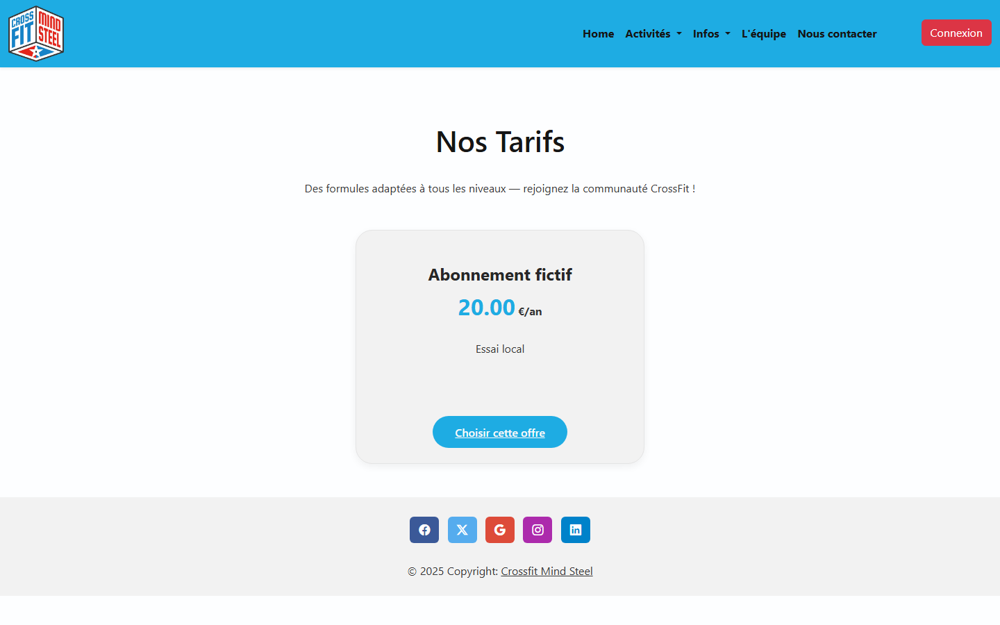

# CrossFit Management

**Projet académique développé collectivement dans le cadre de notre formation en informatique.**

CrossFit Management est une application web de gestion d’une salle de CrossFit. Elle réunit la présentation publique des activités, la gestion des cours et des adhésions, et trois espaces de travail adaptés aux propriétaires, aux coachs et aux membres.

## Objectifs

- Centraliser les salles, les activités, le planning et les abonnements.
- Permettre aux membres de réserver un cours et de consulter leur historique.
- Donner aux propriétaires et aux coachs des interfaces pour organiser les séances et suivre leur activité.

## Fonctionnalités

| Espace | Fonctionnalités développées et état des vérifications |
| --- | --- |
| Public | Présentation des activités, liste des coachs, calendrier découverte, tarifs, demande d’essai et formulaire de contact. Les lectures des coachs, des séances et des tarifs ainsi que l’enregistrement d’une demande d’essai ont été testés avec des données fictives. |
| Authentification | Connexion, déconnexion, rôle en base, accès restreint, activation sur invitation et réinitialisation de mot de passe. Tests HTTP sur les trois rôles et sur l’utilisation unique des liens avec des jetons fictifs. L’envoi des liens par SMTP reste à tester. |
| Propriétaire | Gestion des salles, membres, demandes de désactivation, activités, cours et abonnements. La lecture des listes, la création, la modification et l’activation d’une salle, la création d’un cours et la création d’une formule d’abonnement ont été testées. |
| Coach | Consultation du planning, détail des séances, organisation de cours et lecture des avis des membres. Les lectures du planning, du détail des séances et des avis ainsi que la création d’un cours ont été testées. |
| Membre | Tableau de bord, profil, consultation des abonnements, réservation et calendrier personnel. La réservation, le refus d’un doublon, l’envoi d’un avis au coach et la lecture de l’historique des performances ont été testés. L’historique exploite les résultats et commentaires associés aux séances. |
| Intégrations | Stripe Checkout pour l’achat d’un abonnement, PHPMailer pour les courriels, carte intégrée sur la page de contact. Le parcours de paiement et les services externes restent à valider de bout en bout. PayPal est un prototype sans parcours applicatif complet. |

## Technologies et architecture

- **Serveur** · PHP, API HTTP/JSON, MySQL via MySQLi et requêtes préparées.
- **Interface** · JavaScript, Vue.js 3, Bootstrap 5, FullCalendar, DataTables et Chart.js. Les bibliothèques d’interface distribuées par CDN nécessitent un accès Internet.
- **Intégrations PHP** · PHPMailer 6.11.1 et Stripe PHP 19.0.0 avec le fichier de certificats issu du correctif 19.4.2. [Avis de sécurité Stripe](https://github.com/stripe/stripe-php/issues/2180)

```text
index.php        Point d’entrée et résolution des pages
router.php       Routeur pour le serveur PHP de développement
front/           Pages et composants PHP
js/              Applications Vue et scripts des pages
back/API/        Routes publiques et routes par rôle
back/check_auth.php
                 Contrôle des sessions et résolution des rôles
config/          Configuration MySQL, SMTP et paiements
database/        Schéma MySQL sans données
css/ et img/     Styles et ressources visuelles
```

## Installation locale

Prérequis · PHP 8.3 avec `mysqli`, `mysqlnd`, `mbstring`, `fileinfo`, `curl` et `openssl`, et MySQL 8. Le projet inclut déjà ses bibliothèques PHP. Leur chargement ne nécessite aucune installation Composer.

1. Ouvrir un terminal à la racine du dépôt.
2. Démarrer MySQL, créer une base vide et importer le schéma selon les instructions ci-dessous.
3. Copier [config/local.example.php](config/local.example.php) vers `config/local.php`, qui est ignoré par Git. Renseigner `db_host`, `db_port`, `db_name`, `db_user` et `db_password`. Laisser `base_url` à `http://127.0.0.1:8000` pour la commande suivante.
4. Démarrer PHP depuis la racine.

   ```sh
   php -d display_errors=0 -S 127.0.0.1:8000 router.php
   ```

5. Ouvrir [l’application locale](http://127.0.0.1:8000/). Pour essayer les espaces privés, créer un compte fictif selon la procédure ci-dessous. Le répertoire `img/avatar/` reçoit les avatars téléversés et doit être accessible en écriture à PHP.

### MySQL

Lancer `mysql -u root -p` depuis la racine du dépôt, ou utiliser un compte administrateur local équivalent. Choisir un mot de passe local unique pour le compte applicatif et remplacer la valeur d’exemple avant d’exécuter ces commandes.

```sql
CREATE DATABASE crossfit_management CHARACTER SET utf8mb4 COLLATE utf8mb4_0900_ai_ci;
CREATE USER 'crossfit_app'@'localhost' IDENTIFIED BY '<mot de passe local>';
GRANT SELECT, INSERT, UPDATE, DELETE ON crossfit_management.* TO 'crossfit_app'@'localhost';
USE crossfit_management;
SOURCE database/schema.sql;
```

Le schéma est vide. Voici comment créer un premier propriétaire fictif avec un compte administrateur local. Générer d’abord le hash d’un mot de passe de démonstration avec `php -r "echo password_hash(trim(fgets(STDIN)), PASSWORD_BCRYPT), PHP_EOL;"`. Saisir le mot de passe fictif lorsque PHP attend une entrée, puis copier le hash dans l’insertion.

```sql
USE crossfit_management;

INSERT INTO user (
    lastName_user, firstName_user, birthdate_user, gender_user,
    streetNameAddress_user, numeroAddress_user, postalCode_user, town_user,
    emailAddress_user, password_user, dateInvitation_user, dateCreation_user,
    wound_user, actualLevel_user, notesCoach_user
) VALUES (
    'Démo', 'Propriétaire', '1990-01-01', 'Non renseigné',
    'Rue fictive', '1', '00000', 'Ville fictive',
    'proprietaire@example.invalid', '<hash bcrypt>', CURRENT_DATE, CURRENT_DATE,
    '', '', ''
);

INSERT INTO owner (id_user, email_owner, telephone_owner)
VALUES (LAST_INSERT_ID(), 'proprietaire@example.invalid', '000000000');
```

Pour adapter une base issue d’une version précédente, sauvegarder la base, puis vérifier les colonnes `box.actif_box` et `boxuser.idPayment_boxuser` ainsi que l’index unique du second champ dans [le schéma](database/schema.sql). Les liens de réinitialisation générés avant l’introduction du hachage doivent être renouvelés.

### Intégrations facultatives

- **SMTP** · Renseigner `smtp_host`, `smtp_port`, `smtp_user`, `smtp_password`, `smtp_from` et `contact_recipient` avec un compte de test. Les courriels utilisent l’URL de base configurée pour les liens d’invitation et de réinitialisation.
- **Stripe** · Renseigner `stripe_secret_key` avec une clé de test renouvelée et configurer `base_url` pour les retours Checkout. Valider le parcours complet en environnement de test avant tout usage réel.
- **PayPal** · Les paramètres existent pour le prototype. Le site propose uniquement Stripe dans le parcours d’achat.

## Captures d’écran

La page des tarifs dans Chrome. La formule affichée provient d’une base MySQL de test et utilise des données fictives.



## Limites et améliorations possibles

- L’anti-doublon des essais filtre aussi par adresse IP, ce qui peut bloquer plusieurs personnes partageant une connexion.
- Ajouter des tests automatisés reproductibles et étendre les scénarios de mutation, de validation des formulaires et de contrôle par salle.
- Renforcer la limitation des tentatives de connexion et le contrôle des opérations sensibles par objet. Le rôle propriétaire donne actuellement accès à une administration globale de l’application.
- Valider SMTP et Stripe en environnement de test, puis étudier la confirmation asynchrone des paiements par webhook.
- Pour un déploiement, utiliser HTTPS, désactiver l’affichage des erreurs PHP et limiter explicitement les chemins publics. Le routeur fourni est conçu pour le développement local.

## Contributions

Ce dépôt présente un travail d’équipe. La répartition nominative des contributions pourra être ajoutée après validation par les membres du groupe.
